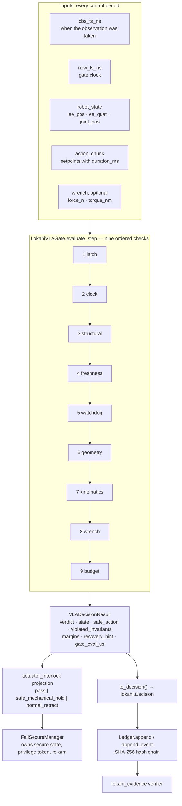
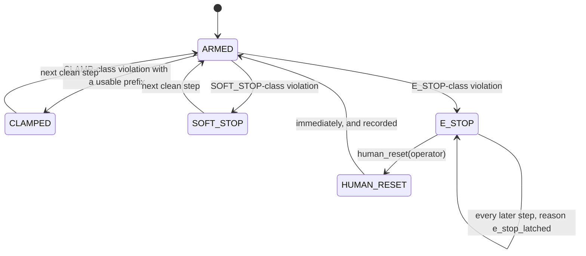

# The LOKAHI VLA gate

This document describes LOKAHI **v1.4.0-draft**, which lives inside the **v1.3.1** branch: `tools/vla/` is in the tree, `lokahi.__version__` still reads `1.3.1`, and nothing described here has been released, benchmarked or certified.

It is written for two readers. An integrator needs to know what the gate guarantees, in what order, and what it expects to be handed. An underwriter needs to know where the guarantees stop. The last two sections exist for the second reader and are not marketing copy.

## What the gate is

`LokahiVLAGate` sits between a Vision-Language-Action policy and an actuator. The policy proposes a *chunk* — a short sequence of setpoints the controller will stream — and the gate decides, before the first setpoint moves, whether the chunk may execute as written, may execute truncated, or must not execute at all. It decides inside the control period, from data the controller already has, with no learned component of its own.

Two properties matter more than any individual check.

**One source of truth per physical limit.** Force, torque and workspace ceilings are read from the manifest's existing `physical_envelope`. The `physical_vla` section is *refused* if it restates one — `VLAManifestError: may not restate envelope limits`. Two copies of a force ceiling is the failure this module exists to prevent, so the loader will not let you create one.

**Fail closed on the configuration.** An unsigned, unverifiable, unparseable, expired-per-your-verifier, unknown-keyed or out-of-range section never falls back to a default. `load_physical_vla` raises and the gate is never constructed. There is no "gate with no bounds".

## Flow



The gate has no I/O and no clock of its own beyond `perf_counter_ns` for its budget. Timestamps are arguments. That is what makes one step reproducible from an episode log.

## The nine checks, in order

The order is normative and cheap-first, the same discipline as the fifteen rules in `lokahi.evaluate`: anything that makes the action *meaningless* is decided before anything that merely makes it *unsafe*. Checks 2 through 8 accumulate violations rather than returning at the first one; check 1 is the only short circuit. After all checks run, the most severe action configured for the classes that fired is selected.

| # | Check | What it reads | Why it comes here |
|---|---|---|---|
| 1 | **latch** | `gate.state == E_STOP` | Once an E-class violation has fired, no later input can be trusted. Refusing here costs one comparison, and a latched gate cannot be argued out of its latch by a well-formed chunk. Returns `FORBIDDEN` / `e_stop_latched`. |
| 2 | **clock** | `now_ts_ns`, `obs_ts_ns` against the last `now_ts_ns` | Every age below is a subtraction of these two numbers. A backwards clock turns freshness into nonsense and a future observation turns it negative, so monotonicity is settled before any age is computed. |
| 3 | **structural** | chunk shape, `ee_pos` length 3, finite numbers, `\|q\| = 1 ± 1e-6`, joint vector shape | If the geometry cannot be computed, no later check means anything. A non-unit quaternion makes the rotation angle a fiction; NaN makes every comparison false in the permissive direction. |
| 4 | **freshness** | `obs_ts_ns`, and each element's `duration_ms` | A command for a world that has moved on is the characteristic VLA failure: slow inference on a fast robot. Age is per element — element *i* is `(now − obs) + Σ duration of elements before it` — so the tail of a long chunk dies before the head. |
| 5 | **watchdog** | `now_ts_ns` minus the last completed step | A gap means the pipeline stalled and then resumed. Silence denies in LOKAHI, so a resumed step after a long gap is refused rather than executed as if nothing happened. |
| 6 | **geometry** | `ee_pos`, `workspace_aabb`, `keep_out_aabbs`, `tool_radius_m` | The whole polyline from the current pose through every setpoint is swept, not just its vertices. A keep-in region is convex, so all vertices inside implies all of it inside; a keep-out region is not, so each consecutive pair gets a slab test — otherwise a chunk can pass straight through an obstacle with both endpoints legal. |
| 7 | **kinematics** | per-step displacement, geodesic quaternion angle, `joint_limits` | A per-setpoint bound is what the controller will actually execute. Checking the chunk's endpoint alone would let a loop pass any endpoint test while bending further mid-chunk. |
| 8 | **wrench** | `wrench.force_n`, `wrench.torque_nm` against `physical_envelope` | Contact is the one channel where the world pushes back. It is measured, not predicted, so it is checked last among the physical quantities and its margin can legitimately be negative. |
| 9 | **budget** | `gate_eval_us` against `max_gate_eval_us` | A gate that cannot answer within the control period must not answer "allowed". Overrun rewrites the result to `FORBIDDEN` / `SOFT_STOP` with reason `budget_exceeded`, the same pattern the WASM preflight uses. |

Two details the code relies on and a reviewer should check against it: a three-axis force is compared by its L2 norm (`_scalar_or_norm`), and the rotation angle is `2·acos|q₁·q₂|`, so `q` and `−q` are the same rotation, as they should be.

## The state machine



| State | `allowed` | Gate behaviour | Latched? |
|---|---|---|---|
| `ARMED` | yes | the chunk executes as written | no |
| `CLAMPED` | yes | only `safe_action["actions"]` executes — the prefix before `clamped_from_index`. A clamp to index 0 is downgraded to `SOFT_STOP`, because an empty prefix is not an action | no |
| `SOFT_STOP` | no | `safe_action` is a hold at the current pose and joints | **no** — the next clean step returns to `ARMED` |
| `E_STOP` | no | hold; every subsequent step is refused with `e_stop_latched` | **yes** — absorbing until a named human resets |
| `HUMAN_RESET` | no | transient only: `human_reset(operator)` sets it, captures `previous_state`, and returns the gate to `ARMED` in the same call | never observed in a result |

`SOFT_STOP` not latching is deliberate in the code as written but has consequences an integrator must understand: it is a per-step refusal, not a trip. If the policy keeps producing the same violating chunk, every step refuses — but a single good chunk in between re-arms the gate silently. Only `E_STOP` requires a human.

### Projection onto `FailSecureManager`

There is no second state machine. `FailSecureManager` owns secure-state entry, the privilege token and re-arm; the gate's state names only say what the interlock should do on *this* step, through the same three-value vocabulary every `lokahi.Decision` already carries.

| Gate state | `result.interlock` | Meaning for the consumer |
|---|---|---|
| `ARMED` | `pass` | issue the chunk |
| `CLAMPED` | `pass` | issue the clamped prefix; the refusal is in `violated_invariants` |
| `SOFT_STOP` | `safe_mechanical_hold` | hold at `safe_action.hold_pose` / `hold_joints` |
| `E_STOP` | `normal_retract` | hold and retract; requires `human_reset` before anything else |
| `HUMAN_RESET` | `safe_mechanical_hold` | not reachable in a returned result; listed for completeness |

One honest wrinkle: for `E_STOP` the payload is a hold — `hold_pose` and `hold_joints` of the current state — while the `mode` label says `normal_retract`, mirroring the engine's vocabulary. The gate does not plan, verify or gate a retract path. Read `safe_action` as *hold here*, and let the controller own how it gets clear.

## Quickstart

A manifest is a signed JSON document. The VLA section adds only what `physical_envelope` lacks; force and torque stay where they already are.

```json
{
  "node": "amr-07-arm",
  "informational": ["joint_state", "force_trace"],
  "forbidden_targets": ["damping_kd"],
  "jurisdiction": "IN-DL",
  "residency": ["IN-DL"],
  "exceptions": {"safety_critical": 3, "window_hours": 24},
  "expires": "2027-06-01T00:00:00Z",
  "steward": "did:web:lokahi.example",
  "signature": "<hex over the document without this field>",
  "physical_envelope": {"max_contact_force_n": 140.0, "max_joint_torque_nm": 45.0},
  "physical_vla": {
    "max_action_age_ms": 150.0,
    "watchdog_timeout_ms": 500.0,
    "max_gate_eval_us": 2000.0,
    "control_period_ms": 20.0,
    "execution_mode": "sync",
    "workspace_aabb": [0.2, -0.6, 0.0, 1.4, 0.6, 1.2],
    "keep_out_aabbs": [[0.6, 0.2, 0.0, 0.8, 0.4, 1.2]],
    "tool_radius_m": 0.06,
    "kinematic_limits": {"max_pos_delta_m": 0.05, "max_rot_delta_rad": 0.35},
    "policy_on_violation": {"stale_action": "CLAMP", "workspace_keep_out": "E_STOP"}
  }
}
```

Five lines, from a document on disk to a recorded decision:

```python
doc = json.load(open("robot-manifest.json", encoding="utf-8"))
gate = LokahiVLAGate.from_manifest(doc, verifier=verify_raw_document)   # must hash the raw document
result = gate.evaluate_step(obs_ts_ns, now_ts_ns, robot_state, action_chunk, wrench={"force_n": 12.0})
if not result.allowed:
    controller.hold(result.safe_action)
ledger.append(result.to_decision(), action, Manifest.from_dict(doc))
```

`verify_raw_document` is yours to supply and is called before any bound is read. It must hash the *whole* document, `physical_vla` included: `Manifest.to_dict()` omits the VLA section, so a `lokahi.Manifest` round trip cannot carry it and `Manifest.sign()` would leave the gate's limits unsigned. Verifying the raw document is what makes a mutated `max_action_age_ms` fail as `unverifiable_manifest` instead of taking effect. `load_physical_vla` checks the signature via your callback and nothing else — it does not check `expires`, so if expiry must be enforced, enforce it in that same callback.

What comes back, for a benign two-setpoint chunk with 12 N of contact:

```
verdict=COMPLIANT  state=ARMED  interlock=pass  allowed=True
margins={'oldest_action_age_ms': 20.0, 'keep_in_margin_m': 0.14, 'force_margin_n': 128.0}
```

and for a chunk that crosses a keep-out box, with the same `policy_on_violation` as above:

```
verdict=FORBIDDEN  state=E_STOP  interlock=normal_retract  allowed=False
violated_invariants=['workspace_keep_out:0:segment_1', 'kinematic:pos_delta:0:0.3066m>0.05m']
safe_action={'mode': 'normal_retract', 'hold_pose': [0.44, 0.02, 0.6], 'hold_joints': [...]}
recovery_hint={'state': 'E_STOP', 'violated_classes': [...], 'requires_human_reset': True,
               'action': 'replan_path_around_obstacle', 'chunk_length': 2}
```

Every violation is a stable `class:detail` string, so a log filter or a dashboard can key on the class prefix without parsing prose. `recovery_hint` is machine-readable direction for a recovery policy, and by construction it never suggests relaxing a limit.

## Recording

`result.to_decision()` returns a `lokahi.Decision` so the existing ledger carries VLA steps unchanged; `result.interlock` becomes `actuator_interlock`. Two facts about that mapping are worth stating plainly:

- **A `CLAMPED` step is recorded as `compliant`**, with the clamping reason in `reasons`. The engine's verdict vocabulary is `compliant | escalate | forbidden` and has no "clamped", and adding one would change every consumer of the chain. A reader who filters on `verdict` alone will see a clean step; the evidence that it was truncated is in `reasons` (`kinematic:pos_delta:0:...`).
- **The gate writes nothing.** No file, no append, no log. `human_reset` returns a `vla_human_reset` record — operator, previous state, timestamp — and the caller appends it with `ledger.append_event(...)`. A reset that is not appended is a reset with no evidence.

Receipts and a `lokahi-vla-verify` CLI are **planned for v1.4.0** (ROADMAP V-07) and are not in this tree. The latency and injection benchmark is **planned** as V-08. No performance number is quoted in this document, and none should be quoted for this gate until that harness has run on named hardware and its corpus hash is published alongside it.

## Limits of what this version knows

These are properties of the code as it stands, verified by running it, not aspirations. They belong in the safety case.

- **A `robot_state` without `ee_pos` disables checks 6 and 7 silently.** Geometry and kinematics are skipped when the current position is missing, and a chunk five metres outside the workspace returns `COMPLIANT` / `ARMED` with no violations. The gate trusts the caller to hand it a robot state. Requiring `ee_pos` and refusing without it is the obvious hardening and is not in v1.4.0-draft.
- **`max_joint_vel_rad_s` and `max_joint_acc_rad_s2` are accepted, validated, stored — and never evaluated.** Velocity and acceleration are not enforced by the gate; only displacement per setpoint, via `max_pos_delta_m`, and only if that is configured. A manifest that sets a velocity ceiling and nothing else gets no velocity checking.
- **`duration_ms` feeds freshness only.** Displacement is compared to a distance bound, never divided by the setpoint's duration, so a chunk of very short duration can exceed any intended speed while each delta stays under `max_pos_delta_m`.
- **The tool is a sphere of `tool_radius_m`.** An elongated or rotating tool is modelled by one scalar radius around the end-effector point; orientation is not part of the geometry test.
- **The watchdog detects a late step, not a silent pipeline.** It fires only when `evaluate_step` is called after a gap. If the policy stops calling entirely, the gate is never invoked and reports nothing; that failure is the controller's own watchdog to catch.
- **`SOFT_STOP` is per-step, not a trip.** See the state table above.
- **The quaternion convention is assumed to be `(w, x, y, z)`.** A client sending `(x, y, z, w)` produces a valid unit quaternion and arithmetically wrong angles. Nothing checks the convention.
- **`source` is accepted and unused.** `evaluate_step(..., source="vla")` records nothing with it and changes no decision.
- **`execution_mode` is validated and stored, not acted on.** `sync`, `lazy_async` and `continuous_async` are all accepted; the gate evaluates one chunk per call in every mode. Scheduling is the integrator's.
- **Accounting, not certification.** `steps_evaluated` and `interventions` are counters on the gate instance, not verified evidence.

## What this is not

**It is not a safety-rated control function.** The gate is general-purpose Python running on a general-purpose operating system with a garbage collector. It has no diagnostic coverage, no redundant channel, no measured failure rate, no validated toolchain under ISO 25119-3 or IEC 61508-3. It **cannot be credited as PL d under ISO 13849-1** — there is no category, no MTTFd, no DCavg, and no architecture to assess — and it cannot be part of a machine builder's claim that a safety-related control function reaches PL d, because the software it runs on was not developed or verified to that standard.

**It does not replace the controller's protective stop.** The gate decides whether a chunk may be issued. Stopping the drive is the controller's protective stop, rated category 0, 1 or 2 per IEC 60204-1, on independent hardware with its own stopping-time measurement. `E_STOP` here is a latch that refuses further chunks and asks the consumer to hold; it is not an emergency-stop circuit, and nothing in this module claims a stopping time, a stopping distance, or a reaction time.

**It is not a certification, a conformity assessment, or a CE mark.** It is not an evaluation under ISO/IEC TS 8200:2024 and produces no AgPL or SIL. Nothing here substitutes for a risk assessment under ISO 12100 or for the integration duties of ISO 10218-2:2025. `docs/STANDARDS_MATRIX.md` maps each control to the clause it supports and states the gap for every row, including the rows this section names.

**It is not a monitor of the world.** No perception, no human tracking, no live separation distance. The keep-out boxes are static configuration and the wrench is whatever the caller measured. A wrong box is honoured exactly, and a chunk that is safe by the boxes and dangerous in the cell is allowed.

**It is not a consent gate.** Quorum, operator disjointness, suspension and the timeout refusal live in `lokahi.evaluate`. The gate does not run them; it produces a decision shaped for the ledger that function writes, and an integrator who needs both calls both.

A machine that uses LOKAHI to reach a safety rating must do so as a *system*: LOKAHI contributes refusal logic and a record. The protective stop, the risk assessment, the validation in the cell, and the legal declaration of conformity belong to the machine builder.
